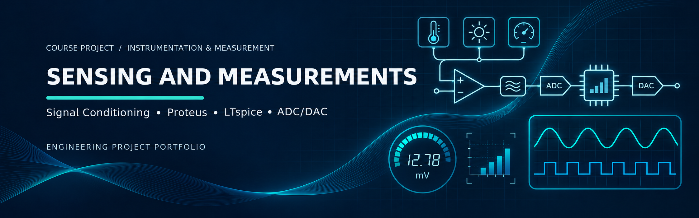
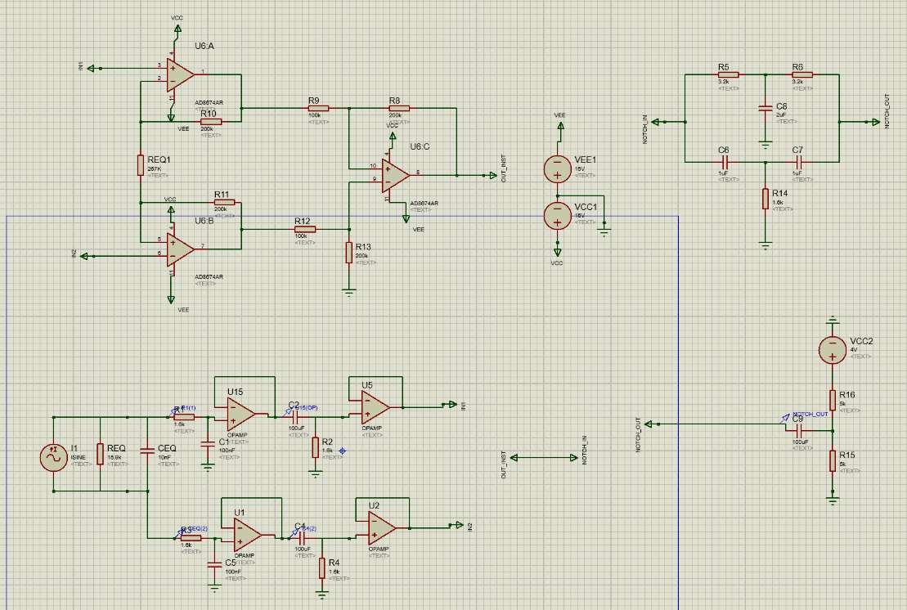
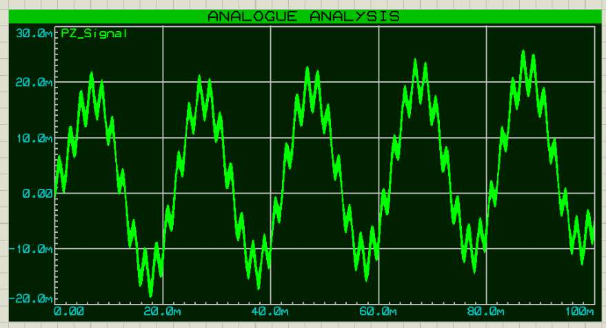
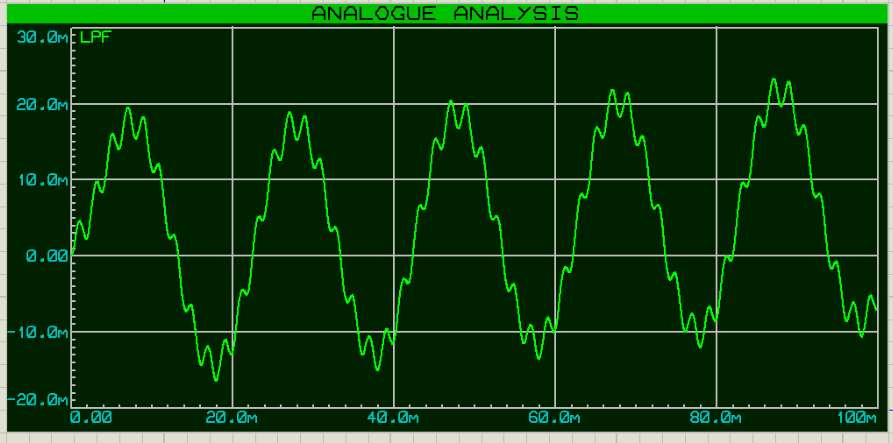
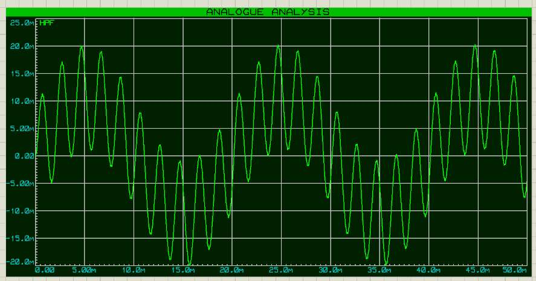
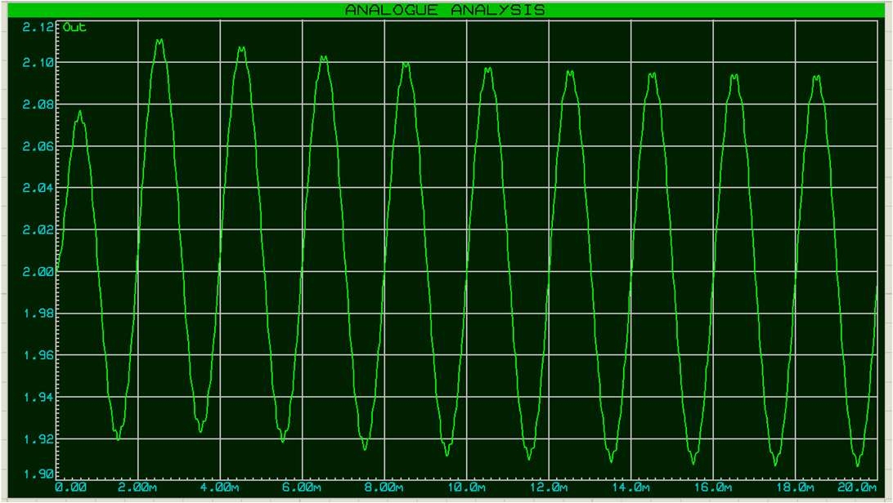
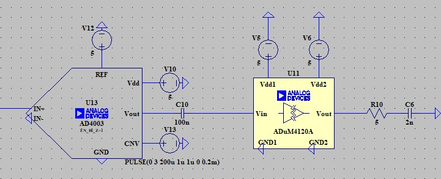
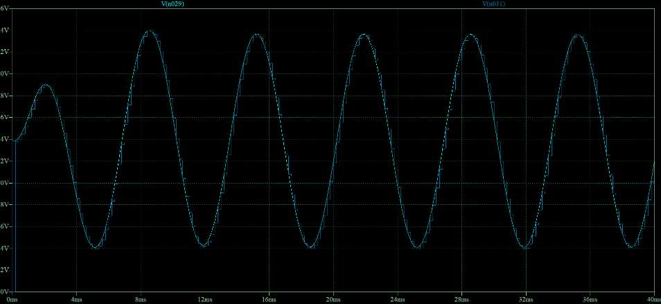
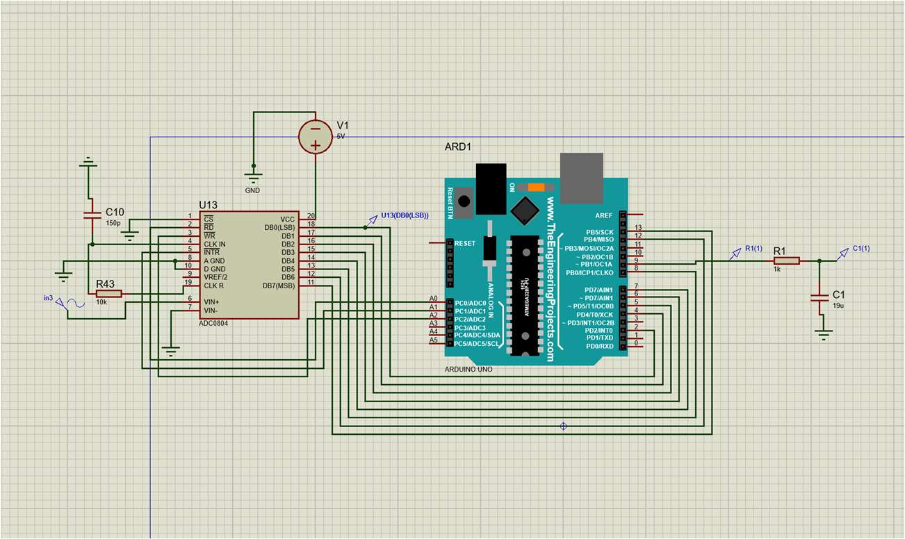
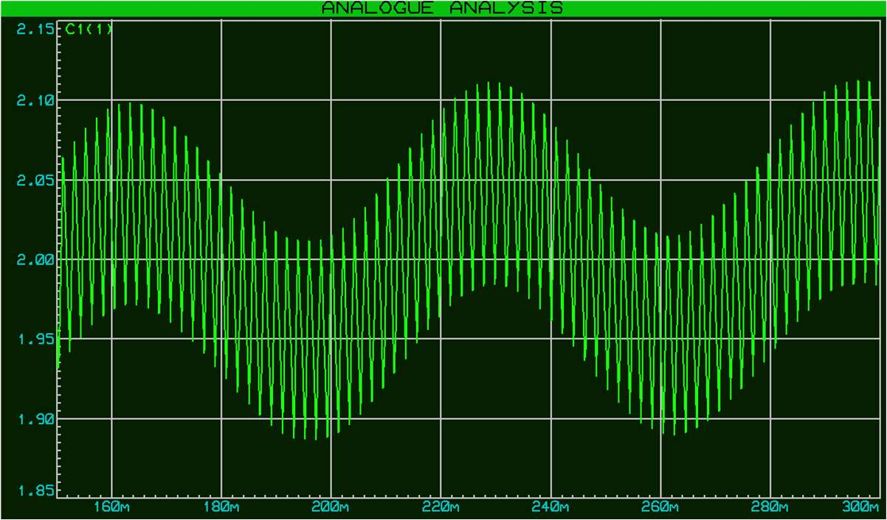

# Sensing and Measurements



## Robot Wrist Vibration Monitoring and Signal Conditioning

This project designs and simulates a signal-acquisition and analog-conditioning system for monitoring vibration during the final position of a robotic wrist movement.

The submitted report describes a potentiometer for wrist-angle measurement and a piezoelectric sensor for capturing mechanical vibration. The analog front end is designed to improve signal quality and reduce unwanted interference.

## Project scope

- Piezoelectric vibration-sensor signal modeling.
- Analog signal conditioning and amplification.
- High-pass and low-pass filtering.
- Instrumentation-amplifier stage.
- 50 Hz notch filtering and DC biasing.
- Simulation of the conditioned signal in Proteus/LTspice.
- Bonus ADC and DAC simulation stages.

## Repository structure

```text
Sensing-and-Measurements/
├── README.md
├── report/
│   └── Sensing_and_Measurements_Project_Report.pdf
├── presentation/
│   └── Sensing_and_Measurements_Presentation.pptx
├── Proteus/
│   ├── PROTEUS.pdsprj
│   ├── ADC.pdsprj
│   └── DAC.pdsprj
├── LTSpice/
│   └── LTSpice.asc
└── images/
    ├── banner.png
    └── Proteus/LTspice simulation screenshots
```

## Software

- Proteus Design Suite — analog front-end, ADC, and DAC project files.
- LTspice — analog simulation schematic.
- PowerPoint — project presentation.

## Opening the project files

- **Proteus:** open the required `.pdsprj` file from the `Proteus/` folder. `PROTEUS.pdsprj` contains the main analog-conditioning project; `ADC.pdsprj` and `DAC.pdsprj` are the additional conversion projects.
- **LTspice:** open `LTSpice/LTSpice.asc`.

The project files are preserved in their submitted formats. Successful execution may depend on the locally installed simulator version and component libraries.

## Simulation gallery

The README gallery contains only actual circuit/simulation screenshots and waveform outputs taken from the submitted report. No handwritten pages are included.

### Analog signal conditioning











### ADC and DAC simulations









## Notes

- The uploaded archive contains the Proteus project files, one LTspice schematic, the report, and the presentation.
- A separate Arduino `.ino` source file was not present in the uploaded archive; Arduino code snippets are shown in the submitted report/presentation.
